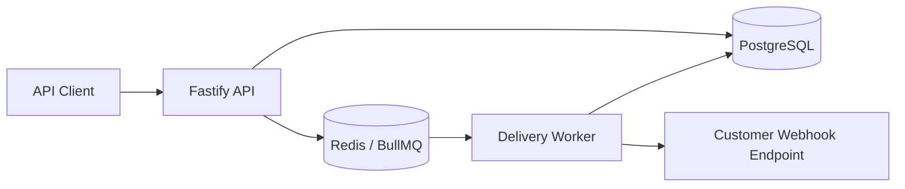

# HookRelay

HookRelay is a **production-grade, multi-tenant webhook delivery platform** for sending and tracking
webhooks through a single API. Accounts publish events, and HookRelay signs each one with **HMAC-SHA256**
and delivers it to every endpoint subscribed to that event type.

The system is a **TypeScript monorepo** with an **API** and a **worker** that run as independent
processes. It uses **PostgreSQL** for durable state, **Redis and BullMQ** for background delivery, and
separate packages for the database, queue, and shared code, so each part can change on its own. Failed
deliveries are **retried with exponential backoff** and then **dead-lettered**, access is through a
**JWT or an API key**, and the worker blocks requests to private addresses in production.

The rest of this document covers the features, architecture, setup, and a curl walkthrough.

## How it works

1. **Create an application** and register the URLs that should receive your events.
2. **Publish an event** with any JSON payload.
3. **HookRelay delivers it** to each subscribed endpoint, signed so receivers can trust it.
4. **Failed deliveries are retried** automatically with increasing delays.

## Features

- **Authentication:** sign up and log in for a JWT, or generate an API key (`hr_...`) for server-to-server calls.
- **Applications and endpoints:** group endpoints under an application and subscribe each one to event types.
- **Asynchronous delivery:** events are queued in Redis and sent by a separate worker, so publishing stays fast.
- **Signed webhooks:** every delivery carries an HMAC-SHA256 signature and timestamp, using a per-endpoint secret.
- **Retries with backoff:** failed deliveries are retried with increasing delays, then marked dead-lettered.
- **Delivery tracking:** each delivery's status, response code and error are stored in Postgres.
- **SSRF protection:** in production the worker refuses private and local addresses and never follows redirects.
- **SDK:** a TypeScript client with a signature verification helper.
- **API docs:** interactive OpenAPI docs at `/docs`.

## Architecture



- **API:** validates the request, stores the event and its pending deliveries in Postgres, and queues them in Redis.
- **Worker:** picks up each job, sends the signed request, and writes the result back to Postgres.
- **Postgres:** the source of truth for events and delivery status.
- **Redis:** the job queue between the API and the worker.

## Quick start

You'll need Node.js 20+, pnpm, and Docker.

```bash
pnpm install
cp .env.example .env
docker compose up -d        # Postgres and Redis
pnpm db:migrate
pnpm dev:api                # API at http://localhost:8000
pnpm dev:worker             # in a second terminal
```

Open `http://localhost:8000/docs` to explore the API.

## Try it with curl

**1. Create an account.** The response contains a JWT `token`. Copy it.

```bash
curl -X POST http://localhost:8000/auth/register \
  -H "content-type: application/json" \
  -d '{"email":"me@example.com","password":"supersecret123"}'
```

Already registered? Use `/auth/login` with the same body to get a new token.

**2. Optional: get an API key.** Use your account id (the `sub` claim inside the JWT) and the token.
The key is shown once, and generating another one replaces it.

```bash
curl -X POST http://localhost:8000/v1/accounts/<ACCOUNT_ID>/api-key \
  -H "authorization: Bearer <TOKEN>"
```

From here on, use either the JWT or the `hr_...` key as `<TOKEN>`.

**3. Create an application.** Copy the `id` from the response.

```bash
curl -X POST http://localhost:8000/v1/applications \
  -H "authorization: Bearer <TOKEN>" \
  -H "content-type: application/json" \
  -d '{"name":"My App"}'
```

**4. Register an endpoint.** The `signingSecret` (`whsec_...`) is only returned once, so save it.

```bash
curl -X POST http://localhost:8000/v1/applications/<APP_ID>/endpoints \
  -H "authorization: Bearer <TOKEN>" \
  -H "content-type: application/json" \
  -d '{"url":"http://localhost:4000/webhook","eventTypes":["order.created"]}'
```

**5. Send an event.** The response lists one `pending` delivery per subscribed endpoint.

```bash
curl -X POST http://localhost:8000/v1/applications/<APP_ID>/events \
  -H "authorization: Bearer <TOKEN>" \
  -H "content-type: application/json" \
  -d '{"eventType":"order.created","payload":{"orderId":42}}'
```

To receive the webhook locally, run the [example receiver](examples/webhook-receiver) and watch its
console and the worker's console. Use `http://localhost:4000/flaky` as the endpoint URL to see retries.

## Using the SDK

```ts
import { HookRelay } from "@hookrelay/sdk";

const hr = new HookRelay(process.env.HOOKRELAY_API_KEY!);

const app = await hr.applications.create({ name: "My App" });

await hr.endpoints.create(app.id, {
  url: "https://example.com/webhooks",
  eventTypes: ["order.created"],
});

await hr.events.create(app.id, {
  eventType: "order.created",
  payload: { orderId: 42 },
});
```

On the receiving side, verify the signature before trusting a webhook:

```ts
import { verifyWebhookSignature } from "@hookrelay/sdk/webhooks";

const result = verifyWebhookSignature({
  secret: process.env.HOOKRELAY_SIGNING_SECRET!,
  rawBody,
  timestampHeader: req.headers["x-hookrelay-timestamp"],
  signatureHeader: req.headers["x-hookrelay-signature"],
});
if (!result.valid) return res.status(401).send(result.reason);
```

More in the [SDK README](packages/sdk/README.md). A working receiver is in
[examples/webhook-receiver](examples/webhook-receiver).

## Project layout

| Path             | What it is                               |
| ---------------- | ---------------------------------------- |
| `apps/api`       | HTTP API                                 |
| `apps/worker`    | Background worker that delivers webhooks |
| `packages/sdk`   | Client SDK (`@hookrelay/sdk`)            |
| `packages/db`    | Database schema and migrations           |
| `packages/queue` | Delivery queue (BullMQ on Redis)         |
| `examples`       | Example webhook receiver                 |

## Development

```bash
pnpm lint
pnpm typecheck
pnpm test
pnpm build
```

Built with TypeScript, Fastify, PostgreSQL, Redis, and BullMQ.
